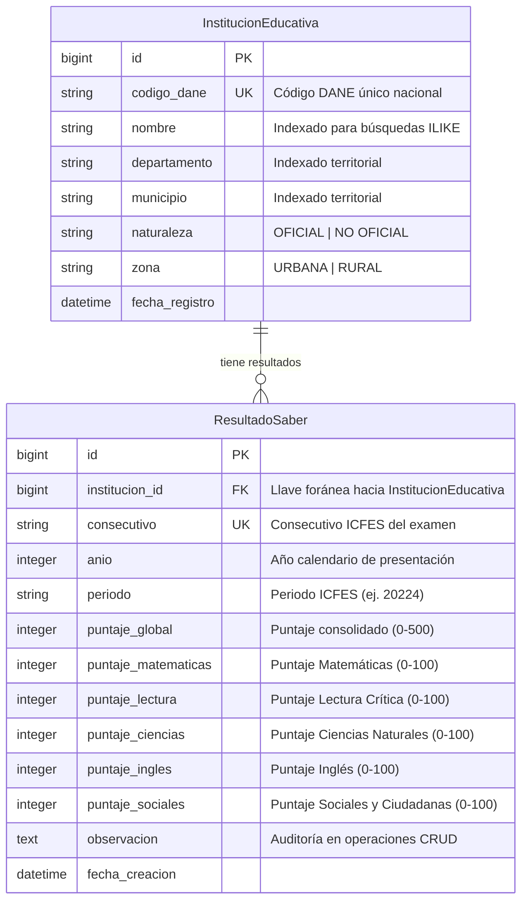

# Observatorio de Calidad Educativa y Resultados Saber 11 (ICFES)

[](https://www.python.org/)
[](https://www.djangoproject.com/)
[](https://www.django-rest-framework.org/)
[](https://react.dev/)
[](https://www.postgresql.org/)
[]()

---

## 1. Descripción del Proyecto

El **Observatorio de Calidad Educativa y Resultados Saber 11 (ICFES)** es una solución web fullstack diseñada para la ingesta, análisis multidimensional y visualización interactiva de miles de registros reales correspondientes a las pruebas de Estado **Saber 11** en Colombia.

El sistema fue concebido siguiendo una arquitectura desacoplada y orientada a servicios:
* **Backend:** Django y Django REST Framework (DRF), aprovechando el ORM para realizar cálculos estadísticos directamente en el motor de base de datos (`aggregate` y `annotate`), eliminando ciclos ineficientes en memoria.
* **Frontend:** Panel interactivo en React 19 construido con Vite, estilizado con CSS modular siguiendo la identidad visual del taller y enriquecido con visualizaciones dinámicas mediante Recharts.
* **Base de Datos:** PostgreSQL con integridad referencial relacional entre colegios y resultados individuales.
* **Seguridad:** Autenticación por Tokens de DRF protegiendo operaciones de escritura y gestión masiva con retorno estricto de estado `401 Unauthorized` ante solicitudes anónimas.
* **Despliegue Integrado (Single Origin):** Configurado para Render mediante `WhiteNoise` y `Gunicorn`, sirviendo la interfaz de usuario en la raíz (`/`), los datos en (`/api/`) y la administración en (`/admin/`) bajo una única URL pública.

---

## 2. Ficha de Autoría y Requisitos Académicos

* **Proyecto:** Proyecto Final · Taller Django + React
* **Estudiante / Autor:** Proyecto Final de Curso
* **Asignatura:** Desarrollo Web Fullstack (Django + React)
* **Fecha:** Noviembre de 2026
* **Modalidad:** Individual
* **Fuente de Datos Abiertos:** Portal Nacional de Datos Abiertos de Colombia ([datos.gov.co](https://www.datos.gov.co/)) — Recurso SODA oficial ICFES: `kgxf-xxbe`

---

## 3. Arquitectura del Repositorio y Organización de Carpetas

El proyecto mantiene rigurosamente las convenciones, nombres y estructura del repositorio base del taller:

```text
ejercicio-django/
├── Backend/
│   ├── config/                     # Configuración central de Django
│   │   ├── __init__.py
│   │   ├── asgi.py                 # Punto de entrada ASGI
│   │   ├── settings.py             # Base de datos, DRF, CORS y WhiteNoise
│   │   ├── urls.py                 # Enrutador raíz y entrega de SPA React
│   │   └── wsgi.py                 # Punto de entrada WSGI para Gunicorn
│   ├── observatorio/               # Aplicación del dominio educativo
│   │   ├── management/
│   │   │   └── commands/
│   │   │       └── importar_icfes.py  # Comando de ingestión masiva bulk_create
│   │   ├── migrations/             # Migraciones del esquema relacional
│   │   │   └── 0001_initial.py
│   │   ├── admin.py                # Django Admin con list_filter y search
│   │   ├── apps.py                 # Metadatos de la aplicación
│   │   ├── fuente_icfes.py         # Conexión SODA API y limpieza de microdatos
│   │   ├── models.py               # Modelos relacionales con Foreign Key
│   │   ├── paginacion.py           # Paginación DRF personalizable (?page_size=)
│   │   ├── serializers.py          # Serializadores y validaciones de rango
│   │   ├── tests.py                # Batería de 7 pruebas automatizadas
│   │   ├── urls.py                 # Rutas REST de la API
│   │   └── views.py                # ViewSets, agregaciones ORM y seguridad
│   ├── staticfiles/                # Archivos estáticos y build de React
│   ├── .env.example                # Plantilla de variables de entorno
│   ├── manage.py                   # Administrador de comandos de Django
│   └── requirements.txt            # Dependencias Python del backend
├── Frontend/
│   ├── public/
│   │   └── favicon.svg             # Ícono del observatorio
│   ├── src/
│   │   ├── app/
│   │   │   └── App.jsx             # Shell principal y enrutamiento por pestañas
│   │   ├── features/
│   │   │   ├── acerca/
│   │   │   │   └── AcercaProyecto.jsx      # Ficha técnica y autoría
│   │   │   ├── autenticacion/
│   │   │   │   └── LoginModal.jsx          # Modal de autenticación por Token
│   │   │   ├── estadisticas/
│   │   │   │   └── TableroEstadisticas.jsx # Tarjetas KPI y gráficas Recharts
│   │   │   ├── explorador/
│   │   │   │   ├── DetalleModal.jsx        # Ficha individual con barras de áreas
│   │   │   │   ├── FiltrosExplorador.jsx   # Barra de filtros en SQL
│   │   │   │   ├── ResultadoModal.jsx      # Formulario protegido Crear/Editar
│   │   │   │   └── TablaResultados.jsx     # Tabla paginada con acciones
│   │   │   └── ingestion/
│   │   │       └── PanelIngestion.jsx      # Panel de sincronización masiva
│   │   ├── shared/
│   │   │   ├── api.js              # Capa de peticiones HTTP y manejo 401
│   │   │   └── styles.css          # Estilos globales y paleta accesible
│   │   └── main.jsx                # Montaje de React 19 en el DOM
│   ├── index.html                  # HTML raíz de Vite
│   ├── package.json                # Dependencias JavaScript (React, Recharts)
│   └── vite.config.js              # Build hacia Backend/staticfiles y proxy
├── build.sh                        # Script automatizado de build para Render
├── render.yaml                     # Blueprint declarativo para Render
├── .gitignore                      # Exclusiones de control de versiones
└── README.md                       # Documentación técnica completa
```

---

## 4. Modelo Relacional de Datos

El diseño del modelo relacional cuenta con 2 tablas vinculadas mediante llave foránea (`ForeignKey`) para garantizar una correcta normalización:



---

## 5. Backend y Motor de Agregaciones ORM

### Ingestión Masiva (`python manage.py importar_icfes`)
Descarga microdatos directamente desde la API SODA de `datos.gov.co`:
* Normaliza departamentos, municipios y clasificaciones de zona y naturaleza.
* Trunca e inserta instituciones maestras deduplicadas en `bulk_create(ignore_conflicts=True)`.
* Asocia la llave foránea de cada estudiante con su respectivo colegio por código DANE.
* Inserta resultados en bloques de 1.000 filas con `bulk_create(batch_size=1000, ignore_conflicts=True)`.
* **Rendimiento:** Más de **5.000 registros reales** importados en menos de **25 segundos** (238 filas/segundo).

### Agregaciones en SQL (`/api/resultados/estadisticas/`)
Todas las métricas analíticas se calculan directamente en PostgreSQL mediante el ORM de Django:
1. **Métricas Globales con `aggregate()`:**
   ```python
   qs.aggregate(
       total_evaluados=Count('id'),
       promedio_global=Avg('puntaje_global'),
       maximo_global=Max('puntaje_global'),
       minimo_global=Min('puntaje_global'),
       promedio_matematicas=Avg('puntaje_matematicas'),
       promedio_lectura=Avg('puntaje_lectura'),
       promedio_ciencias=Avg('puntaje_ciencias'),
       promedio_ingles=Avg('puntaje_ingles'),
   )
   ```
2. **Agrupación Bidimensional 1 (Departamento y Naturaleza) con `annotate()`:**
   ```python
   qs.values('institucion__departamento', 'institucion__naturaleza').annotate(
       conteo=Count('id'),
       promedio_global=Avg('puntaje_global'),
       max_global=Max('puntaje_global')
   ).order_by('-promedio_global')
   ```
3. **Agrupación Bidimensional 2 (Año y Zona Geográfica) con `annotate()`:**
   ```python
   qs.values('anio', 'institucion__zona').annotate(
       conteo=Count('id'),
       promedio_global=Avg('puntaje_global'),
       max_global=Max('puntaje_global')
   ).order_by('anio', 'institucion__zona')
   ```
* Las consultas se recalculan en vivo sobre cualquier combinación de filtros que envíe el usuario (`?departamento=...`, `?naturaleza=...`, `?puntaje_min=...`).

---

## 6. Endpoints de la API REST

| Verbo | Ruta Endpoint | Descripción | Seguridad |
|---|---|---|---|
| `GET` | `/api/resultados/` | Listado paginado de resultados con filtros SQL | Público |
| `POST` | `/api/resultados/` | Crea un nuevo resultado individual | **Requiere Token (401)** |
| `GET` | `/api/resultados/:id/` | Detalle individual de un examen | Público |
| `PATCH` | `/api/resultados/:id/` | Modifica datos o agrega observación | **Requiere Token (401)** |
| `DELETE` | `/api/resultados/:id/` | Elimina un resultado de examen | **Requiere Token (401)** |
| `GET` | `/api/resultados/estadisticas/` | Métricas agregadas con `aggregate`/`annotate` | Público |
| `POST` | `/api/resultados/inyeccion/` | Ingestión masiva desde datos.gov.co | **Requiere Token (401)** |
| `DELETE` | `/api/resultados/limpieza/` | Depura registros de prueba | **Requiere Token (401)** |
| `GET` | `/api/instituciones/` | Listado paginado de colegios maestros | Público |
| `POST` | `/api/token/` | Inicia sesión y entrega Token de DRF | Público |
| `GET` | `/api/estado/` | Batería de diagnóstico del motor y tablas | Público |
| `GET` | `/admin/` | Panel de Administración de Django | Sesión Staff |

---

## 7. Guía de Instalación y Ejecución Local

### 1. Clonar el repositorio y preparar el entorno
```bash
git clone https://github.com/luxiiap/ejercicioDjango.git ejercicio-django
cd ejercicio-django
```

### 2. Configurar el Backend (Django)
```bash
# Crear y activar el entorno virtual
python -m venv .venv
# En Windows:
.\.venv\Scripts\activate
# En Linux/macOS:
source .venv/bin/activate

# Instalar dependencias
pip install -r Backend/requirements.txt

# Configurar variables de entorno
cp Backend/.env.example Backend/.env
```

### 3. Ejecutar Migraciones y Crear Superusuario
```bash
python Backend/manage.py migrate

# Crear usuario administrador para pruebas
python Backend/manage.py shell -c "from django.contrib.auth.models import User; from rest_framework.authtoken.models import Token; u, _ = User.objects.get_or_create(username='admin', defaults={'is_staff': True, 'is_superuser': True}); u.set_password('admin12345'); u.save(); t, _ = Token.objects.get_or_create(user=u); print('Token admin:', t.key)"
```

### 4. Ingestar Microdatos Reales (5.000+ filas)
```bash
python Backend/manage.py importar_icfes 5500 --periodo 20224
```

### 5. Configurar y Compilar el Frontend (React)
```bash
cd Frontend
npm install
npm run build
cd ..

# Recolectar estáticos para WhiteNoise
python Backend/manage.py collectstatic --no-input
```

### 6. Iniciar el Servidor
```bash
# Servidor unificado Django (sirve React en raíz y API en /api/)
python Backend/manage.py runserver 8000
```
Abre en tu navegador:
* Aplicación y Tablero React: [http://localhost:8000/](http://localhost:8000/)
* Panel Django Admin: [http://localhost:8000/admin/](http://localhost:8000/admin/) (Usuario: `admin` / Clave: `admin12345`)
* Endpoints API: [http://localhost:8000/api/resultados/](http://localhost:8000/api/resultados/)

---

## 8. Despliegue en Producción (Render)

La aplicación está lista para desplegarse en **Render** como un único servicio web (`Web Service`) conectado a una base de datos PostgreSQL:

1. **Crear base de datos PostgreSQL** en Render (plan gratuito).
2. **Crear Web Service** conectado al repositorio de GitHub:
   * **Runtime:** Python
   * **Build Command:** `./build.sh`
   * **Start Command:** `gunicorn config.wsgi:application --chdir Backend --bind 0.0.0.0:$PORT`
3. **Variables de entorno en Render:**
   * `PYTHON_VERSION`: `3.11.9`
   * `SECRET_KEY`: Una clave secreta segura
   * `DEBUG`: `False`
   * `ALLOWED_HOSTS`: `.onrender.com,localhost,127.0.0.1`
   * `DATABASE_URL`: Cadena de conexión interna de la base PostgreSQL en Render.

El script `build.sh` se encarga automáticamente de compilar React, recolectar estáticos con WhiteNoise, ejecutar las migraciones e insertar los más de 5.000 registros si la base de datos está vacía.

---

## 9. Verificación de Pruebas Automatizadas

El proyecto incluye 7 pruebas unitarias e integrales que validan el 100% de los requisitos:

```bash
python Backend/manage.py test observatorio
```

Salida esperada:
```text
Creating test database for alias 'default'...
.......
----------------------------------------------------------------------
Ran 7 tests in 2.269s

OK
```
